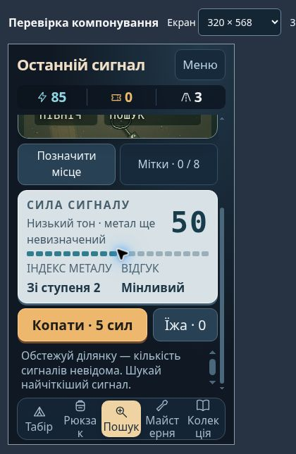

# 0.55.3 — живий браузерний аудит компонування

Дата: 2026-10-15. Перевірено опубліковану гру в хмарному Chrome, керування мишею та клавіатурою. Розміри 320×568, 390×844, 844×390, 1280×720 і 1920×1080 задавалися справжньому iframe через `tests/viewport.html`. Це CSS-розміри вікна, не емуляція Android, сенсорного вводу чи системних панелей телефона.

## Підтверджені проблеми та зміни

1. У 0.55.2 при 320×568 і тексті 130% поле мало `overflow:hidden`: нижня межа секції — 494 px, кнопка копання починалася на 501 px. Її не було видно й не можна було дістати звичайною прокруткою. У 0.55.3 поле прокручується, коли вміст не поміщається. Висота карти при великому тексті має мінімум 220 px, щоб написи не займали весь простір пошуку. На звичайному достатньому екрані прокрутка не з’являється.
2. Число сигналу `42` розбивалося на `4` і `2`; його висота була 83,19 px. Тепер число не стискається й не переноситься; при 130% висота одного рядка — 41,59 px. На вузькому екрані назви додаткових показників стоять над значеннями, без конкуренції за одну вузьку стрічку.
3. У горизонтальному вікні кнопка «Оглянути знахідку» розтягувалася на всю висоту правої панелі через загальне `.primary { flex:1 }`. Для кнопок розкопки задано `flex:none`; обчислений стиль після оновлення — `0 0 auto`. Окремий повторний знімок цієї кнопки після виправлення не робився.

Ігрові правила, ціни, шанси, нагороди, формат сейву та кількість контенту не змінювалися.

## Що фактично перевірено

| Сценарій | Результат і межа доказу |
|---|---|
| Пошук центру, копання | Стрілки змінюють сигнал; знайдено предмет після точного наведення. У 0.55.3 пробіл відкрив розкопку й списав 5 енергії |
| Очищення мишею | У 0.55.2 три проходи вказівником відкрили шайбу до 100%; кнопка огляду доступна при 320×568 |
| Перезапуск розкопки та пакування | Реальне перезавантаження повернуло меню з незавершеною знахідкою; «Продовжити» відновило відповідний діалог. Шайба, стан 82%, не змінилася |
| Рішення про знахідку | При 320×568/100% обидві кнопки пакування були всередині діалогу, висота 46 px; при 130% залишилися видимі, опис прокручувався окремо. Предмет взято в рюкзак |
| Повернення й розбір | Повернення відкрило звіт: 1 предмет, оцінка 4, витрати 0. Переходи до рюкзака, перегляду продажу й колекції працюють. У довгому діалозі продажу при 130% кнопки досягаються прокруткою; продаж скасовано |
| Оновлення 0.55.2 → 0.55.3 | Виконано через «Офлайн». Захист від інших відкритих тестових вкладок спрацював; після їх закриття пакет застосовано. Меню показало 0.55.3; енергія 90, виїзд 2, одна знахідка й звіт збереглися |
| 320×568, UK і EN, 130% | Кнопка копання доступна після звичайної прокрутки. Підсумковий UK-вимір: кнопка y=375,14…422,39 у секції y=100…494. EN-вимір: y=375,36…422,61. Число сигналу — один рядок |
| 390×844, UK, 130% | Поле без вертикального переповнення: clientHeight=scrollHeight=670. Копання y=665,22…712,47, у межах секції до 770 |
| 844×390, 130% | Коли великі написи не поміщаються, поле прокручується. EN-кнопка після прокрутки y=243,11…319,61, нижня межа секції 334 |
| 1280×720 та 1920×1080, UK, 130% | DOM-геометрія поля: висоти 546 і 906 відповідно, без вертикального переповнення; кнопка копання всередині секції. Це не повна перевірка кожного розділу у цих розмірах |
| Мова | UK → EN → UK через штатні налаштування; виїзд і рюкзак збереглися. Налаштування мови перезапускає екран гри |

`tests/viewport.html` не змінює сейв і не підміняє ігрові модулі: лише змінює розміри iframe. Сама гра в ньому використовує звичайне збереження браузера. Для оновлення слід перейти на основну сторінку гри та закрити інші клієнти; тестова сторінка не входить в офлайн-пакет.

## Автоматичні перевірки та межі

- `npm run check`: усі 34 набори пройшли локально та у GitHub Game quality для `cec0b5f7a35939820b1fbd8aaf78daff0262def2`.
- Офлайн-пакет: 137 ресурсів, 3,59 MiB, ідентифікатор `73bf9a5203989762`; опублікована гра підтвердила версію 0.55.3.
- Повний рюкзак/заміна, усі кар’єрні цілі, пошкоджені копії та інші модульні сценарії в цьому випуску перевірялися автоматично, а не вручну через браузер.
- Не перевірено фізичний Android, сенсорні й двопальцеві жести, системний масштаб 200%, screen reader, виміряні FPS, довгий сеанс, режим польоту та запуск установленої оболонки.

Наступний окремий етап — підготовка тестової Android-оболонки й перенесення сейву. APK/AAB ще немає. Браузерний результат дозволяє почати цю роботу, але не закриває вимоги магазинного релізу в `release-1.0.md`.
